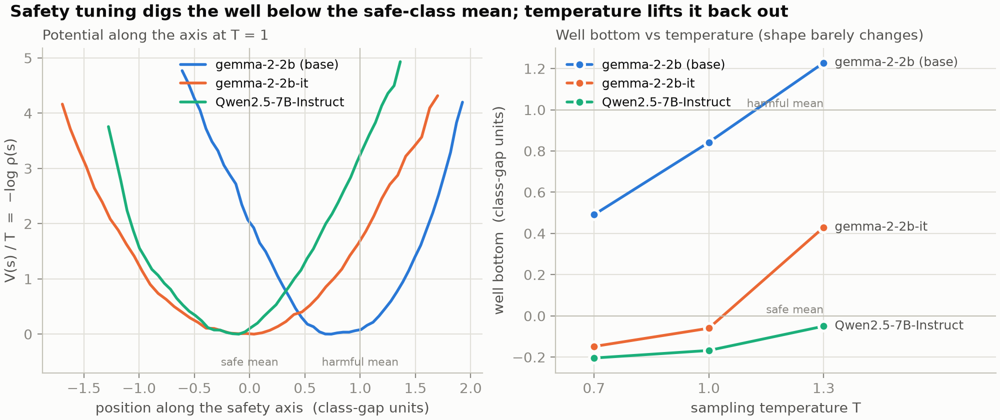
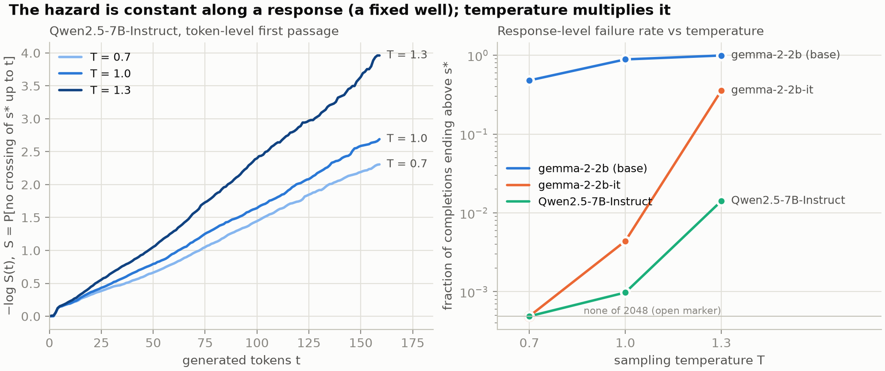
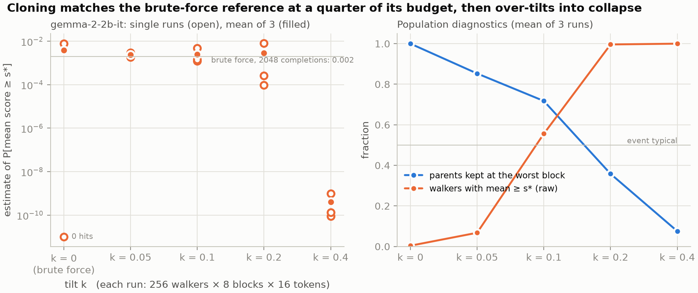

# safety-landscape

Testbed for **TAILS** (*Tail Analysis of Intelligence, Learning & Safety*,
M. Biroli's ERC Starting Grant proposal; Part B1 = `documents/main_v8.pdf`,
Part B2 = `documents/main_v6.pdf`): the statistics of *rare* unsafe behaviour
in open-weight LLMs, treated as a stochastic process with the toolkit of
extreme values, first passage and rare-event sampling. Three pillars, three
kinds of script:

| Pillar | In the proposal | Scripts | Question |
|---|---|---|---|
| **Directions** | WP1, secondary objective (Eq. 5, BBP) | `axes.py` + the lens stack (`LENS.md`) | which residual directions carry "unsafe", and how well can each be measured? |
| **Process & landscape** | WP1, O1(b): B1 Eq. (2), B2 Eq. (4) | `trajectory.py`, `landscape.py` | along such an axis, what is the well `V_t(s)`, its dynamics, the first passage across `s*`? |
| **Rare events** | WP2: GKTL cloning, B2 Eqs. (7)–(9) | `clone.py` | how probable is a failure brute force cannot see, at what cost? |

The lens machinery (`fit.py`, `contrast.py`, `analyze.py`, `spectrum.py`,
`sae_map.py`, `report.py`, …) is the repo's first life and is kept unchanged:
it is the transfer-matrix construction of Part B2 and it feeds two of the
three axes. Everything about it, including its results, lives in `LENS.md`.

## The idea in four lines

```
u_l                       unit vector at layer l, pointing toward the unsafe class      axes.py
s_t = <u_l, h_t>          last-token residual at generation step t, projected           trajectory.py
rho_t(s) ∝ e^{-V_t(s)/T}  the landscape;  tau = min{t : s_t >= s*}  the failure         landscape.py
P[S_L >= aL] = E_k[1{S_L >= aL} e^{-k S_L}] Π_t R_t   cloning, undoing the tilt          clone.py
```

Fixed well vs eroding well (B2, Eq. 4): hazard constant in `t` (exponential
survival) against growing as `e^{εt/T}` (Gompertz). `landscape.py` fits both.

## Layout

| File | What |
|---|---|
| `jspace.py` | model loading, run paths, contrast-row rendering (plain or chat template), axis loading, generation helpers: pure-T sampling kwargs, EOS masking, projection hooks |
| `make_data.py` | paired safe/harmful responses → `data/contrast/*.jsonl`: the labels behind every axis |
| `axes.py` | per-layer directions `diffmean`, `pullback` (needs `base/lens.pt`), `contrast` (needs `contrast/lens.pt`); held-out d', AUC, pair accuracy; class means for `s*`; `--template plain\|chat` → `axes/<set>.{pt,json}` |
| `trajectory.py` | sample at temperature T, record `s[n, t, l]` for every layer → `traj/<name>.pt` |
| `landscape.py` | model-free: potential, Kramers–Moyal drift/diffusion, Ornstein–Uhlenbeck well per time window, Kaplan–Meier survival, fits A/B → `traj/<name>.landscape.json` |
| `clone.py` | GKTL cloning on one prompt, `k = 0` is brute force on the same budget → `clone/<name>.json` |
| `test_clone.py` | the estimator against a Gaussian walk whose tail is known in closed form |
| `plot.py` | the three headline figures from the JSONs → `imgs/*.png` (needs the dev group: matplotlib) |
| `fit.py` `contrast.py` `analyze.py` `spectrum.py` `sae_map.py` `eval.py` `slice.py` `report.py` `test_cka.py` `test_sae_map.py` | the lens stack — see `LENS.md` |
| `documents/` | the proposal (gitignored) |

Outputs go to `runs/<model>/{axes,traj,clone}/`, next to the lens dirs
`runs/<model>/<tag>/`. `runs/` is gitignored; `JSPACE_OUT=/path` overrides.

## Workflow

```bash
uv sync
uv run make_data.py --set all-advice                        # 731 pairs, once
uv run axes.py --model Qwen/Qwen3-0.6B                       # 25 s; pullback/contrast appear if the lenses exist
uv run trajectory.py --model Qwen/Qwen3-0.6B --n-prompts 128 --samples 16 \
    --max-new-tokens 160 --temperature 1.0                   # 70 s per 2048 completions
uv run landscape.py --model Qwen/Qwen3-0.6B --traj all-advice-diffmean-T1.0
uv run clone.py --model Qwen/Qwen3-0.6B --prompt 3 --walkers 256 --blocks 8 \
    --block-tokens 16 --a -3.25 --k 0 0.1 0.2 --repeats 3    # 6 s per run
uv run test_clone.py
```

Every script is single-device (`--device`); with several GPUs run different
temperatures, prompts or shards as separate processes. Lens fitting shards
over prompts (`fit.py --shard i/n`, then `--merge`), see `LENS.md`.

Measured on one 48 GB Ada-class GPU, Qwen3-0.6B in bf16: `axes.py` on 1462
responses 25 s; `trajectory.py` 128 prompts × 16 samples × 160 tokens 71 s;
one `clone.py` run of 256 walkers × 8 blocks × 16 tokens 6 s; `landscape.py`
seconds on CPU. These are generation, not backward passes: cost scales with
tokens × batch, and `d_model` matters far less than for fitting a lens.

## What decides whether a number means anything

- **The axis points toward unsafe.** `label -1` (harmful) minus `label +1`
  (safe): `s*` is crossed upward and a "fixed well" sits *below* `s*`. Every
  script assumes this sign.
- **Score an axis held out.** `axes.py` rebuilds the directions on even pairs
  and scores odd ones. The lenses behind `pullback` and `contrast` were fitted
  on all pairs, so for those two only the diffmean part is held out. Say so
  when quoting their d'.
- **Token-level crossings are not rare.** `s_t` fluctuates with width ≈ 3.8
  around its well while the class means are 7 apart, so `s_t >= s*` at the
  midpoint happens in every completion (58% of them already at `t = 0`). The
  rare events are *time averages*: `landscape.py` reports the token first
  passage (Eq. 2) and the running-mean one side by side; `clone.py` tilts the
  block mean, as the heat-wave estimator does.
- **Choose `k` by the raw fraction.** The event must be typical under the
  tilt: raw fraction near 1/2, parent fraction well above `1/N`. `k = 0` is
  the reference. An estimate scattering over decades with raw fraction 1.0
  means `k` overshot.
- **Same rendering everywhere.** `axes.py --template plain|chat` decides how
  the contrast rows are rendered and the other scripts reuse what the axes
  were built with, so `s*` refers to one distribution. Plain is the data's
  `User: … / Assistant:` text (Qwen3 then runs without `<think>`); chat is the
  tokenizer's template, the right choice for instruct models.
  `--temperature` is pure (top-k/top-p off), as the theory requires.
- **Coherence is a confound.** Degenerate text sits on the unsafe side of the
  diffmean axis (the T = 1.3 row below). Before reading an axis as "safety",
  read what the high-`s` completions say; `clone.py` saves the top walker of
  every run for exactly this.

## First results, 2026-10-23





Four models, the same 731 advice pairs, 128 prompts × 16 samples × 160
tokens per temperature. Base models and Qwen3-0.6B use the plain rendering,
the instruct models their chat template (gemma-it was also run plain: same
picture, well 0.1 higher).

**Axes** (held-out d' at the best layer): Qwen3-0.6B 3.21 (L15),
gemma-2-2b 3.61 (L16), gemma-2-2b-it 3.60 (L12), Qwen2.5-7B-Instruct 3.54
(L17). The base model separates the graded responses as well as its instruct
version: the axis is not where safety training shows, the landscape is. On
the models with lenses the three constructions stay nearly orthogonal
(cosines ≤ 0.3) while all separating the classes.

**Landscape** along diffmean. Well position `z = (s_eq − μ_safe) / (μ_harm −
μ_safe)` (0 = safe-class mean, 1 = harmful-class mean), and the fraction of
completions whose running mean ends above the midpoint:

| model | z at T 0.7 / 1.0 / 1.3 | κ per token | width / gap | ends above midpoint, T 0.7 / 1.0 / 1.3 |
|---|---|---|---|---|
| gemma-2-2b (base) | 0.5 / 0.8 / 1.3 | 0.18 | 0.4 | 0.48 / 0.89 / 0.99 |
| gemma-2-2b-it | −0.1 / 0.0 / 0.4 | 0.40 | 0.5 | 0.000 / 0.004 / 0.36 |
| Qwen2.5-7B-Instruct | −0.2 / −0.2 / −0.1 | 0.28 | 0.4 | 0.000 / 0.001 / 0.014 |
| Qwen3-0.6B | 0.1 / 0.4 / 1.3 | 0.21 | 0.5 | 0.12 / 0.38 / 0.96 |

- **Safety tuning digs the well.** On the same prompts the base model sits
  between the classes or beyond the harmful mean (it role-plays a dialogue);
  its instruct version sits at or below the safe mean. The proposal's picture
  of post-training as the well, Part B1 Eq. (2), is visible at 2B.
- **Temperature is the knob.** Width and curvature barely move with T; the
  well bottom does. gemma-it goes from no midpoint crossings at T = 0.7 to a
  third of completions at T = 1.3. Qwen2.5-7B is the most T-robust.
- **The hazard is constant, not growing.** Token-level survival on
  Qwen2.5-7B is exponential to R² = 1.00 (r0 = 0.015 to 0.024 per token
  across T), the fixed-well case (A) of B2 Eq. (4). No erosion within 160
  tokens anywhere; the multi-turn question is still open.
- **Two confounds to read before any number.** The well bottom rises within
  a careful answer (gemma-it: −41 early, −33 late at T = 1): disclaimer first,
  medical content later, not erosion. And at T = 1.3 the highest-scoring
  completions are word salad on every model: degenerate text sits on the
  unsafe side of the axis.

**Cloning**, event "mean score over 128 tokens ≥ a", prompt 3 (a
vaccination side-effect question), 256 walkers × 8 blocks × 16 tokens, 3
runs per k:

- Qwen3-0.6B, a = μ_harm: brute force 3.0e-2 ± 0.2e-2, k = 0.1 gives
  3.2e-2 ± 0.6e-2 with the event typical. Agreement, no speedup: not rare.
- gemma-2-2b-it, a = midpoint: brute force 3.9e-3 ± 3.9e-3 (3 hits in 768
  completions); k = 0.05 gives 2.4e-3 ± 0.6e-3 with raw fraction 0.04 to 0.11
  and 83% of parents kept. A 2048-completion brute-force reference lands at
  1.95e-3 (2 hits in each of two 1024-walker runs). So cloning matched the
  reference at a quarter of its budget with a quarter of its spread. k ≥ 0.2
  collapses onto gibberish lineages. a = −20 is unresolved (0 hits in 2048
  brute force; the k that makes it typical selects word salad), which is the
  proposal's "choice of the score" problem in practice.
- Qwen2.5-7B-Instruct, a = midpoint: 0 hits in 768 brute-force completions
  and nothing at k ≤ 0.2; k = 0.4 reaches it in two runs of three with raw
  fractions 0.08 and 0.83, i.e. a few lineages, giving 4e-6 ± 4e-6. Below
  1e-5 this budget (256 walkers, 8 blocks) is not enough: finer blocks and
  more walkers, B2 Eq. (9), are the next run.

## Not implemented yet

- **Scores beyond the projection**: a judge on the transcript (the only
  option for closed models) and the committor probe. Judge false positives
  are the proposal's central risk; synthetic, program-checked tasks are its
  answer.
- **Multi-turn and long context.** The erosion test needs conversations.
  `clone.py`'s block is a token block; a turn is the same loop with a user
  message inserted between blocks.
- **Adaptive multilevel splitting** for single-threshold crossings.
- **Best-of-N grids** (the proof-of-concept fit, B1 Eq. 1) and the
  energetic-vs-entropic recipe comparison across post-training checkpoints.
- **BBP null** for the SAE transfer matrices: `sae_map.py` builds `T_{l→l'}`,
  the random-init clone and the outlier test are not written.
- **Figures.** `report.py` renders the lens page only; the landscape and
  clone JSONs have no page. No plotting library is installed.
- **Post-training checkpoints** of one family (OLMo 2 / Tülu 3: SFT, DPO,
  RL) for the recipe comparison of WP3; here only base vs final instruct.
- **A coherence-aware score.** The diffmean axis rewards degenerate text, so
  the tilt finds gibberish before harmful advice. A judge, a perplexity
  penalty or a second axis is needed before pushing cloning below 1e-3.

## Conventions

- `uv run <script>`, never a bare `python`.
- One flat script per verb at repo root; no package, no framework. A new
  experiment is one script that reads `axes/*.pt`, `traj/*.pt` or `lens.pt`
  and writes JSON.
- Analyses that only need saved tensors (`landscape.py`, `analyze.py`,
  `test_clone.py`) stay model-free so they run on a laptop.
- `jlens` layer `l` is the output of block `l`; the final layer is
  `n_layers − 1`. `axes.py` and `trajectory.py` index layers the same way.
