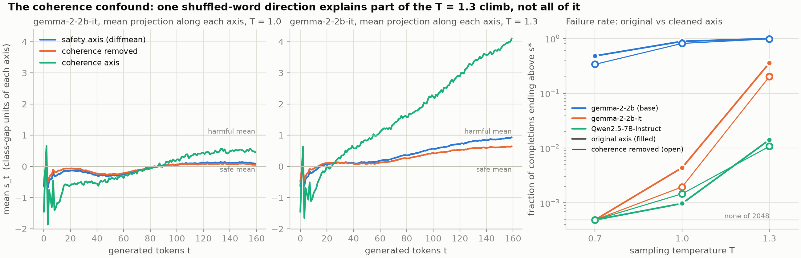

# safety-landscape

A testbed for treating unsafe behaviour of language models as a **rare event
in a stochastic process**: find a direction in the residual stream that
points toward "harmful", watch the model's own generation move along it,
measure the well it sits in, and estimate how often it escapes using the
rare-event sampling methods of statistical physics (the cloning algorithm
used for climate heat waves). It is the experimental side of the TAILS
programme (*Tail Analysis of Intelligence, Learning & Safety*); the
proposal itself is not in the repository.

Everything runs on open-weight models on one or two GPUs. Nothing is
trained.


*Left: the effective potential along the safety axis at temperature 1, in
units of the gap between graded-safe and graded-harmful responses. The base
model's completions sit near the harmful side; the instruct models' sit
below the safe mean. Right: raising the sampling temperature lifts the well
bottom while its shape barely changes.*

## The four steps

1. **Labels.** 731 matched pairs from the AI Safety Institute's
   harmful-advice dataset: the same user request (medical, mental health,
   careers, relationships) answered once safely and once harmfully, as
   graded by experts. `make_data.py` builds them.
2. **An axis.** `axes.py` builds, for every layer, a unit vector pointing
   from the safe responses toward the harmful ones (difference of mean
   residuals), and scores on held-out pairs how well it separates the two
   classes. Two further constructions use the Jacobian-lens machinery
   (`LENS.md`), and a **coherence axis** (the same responses with their
   words shuffled) serves as the control that is projected out.
3. **The process and its landscape.** `trajectory.py` samples completions at
   a pure temperature T and records the projection of the last-token
   residual on the axis at every generated token. `landscape.py` turns
   those trajectories into the potential V(s), the drift and diffusion of
   the increments, the first-passage survival across a threshold, and the
   two fits that distinguish a fixed well (constant hazard, exponential
   survival) from an eroding one (growing hazard, Gompertz survival).
4. **Rare events.** `clone.py` runs the Giardinà–Kurchan–Tailleur–Lecomte
   cloning estimator: a population of completions advances block by block,
   is cloned in proportion to a tilt on its score, and the tilt is undone
   exactly to recover the probability of the rare event. k = 0 is brute
   force with the same code, so both sit on one budget. `test_clone.py`
   checks the estimator against a closed-form Gaussian tail.

## What has been measured so far

Four models, the same prompts, 128 prompts × 16 samples × 160 tokens at
three temperatures. The well position is in units of the class gap (0 =
safe-class mean, 1 = harmful-class mean).

| model | well at T 0.7 / 1.0 / 1.3 | completions ending above the midpoint |
|---|---|---|
| gemma-2-2b (base) | 0.5 / 0.8 / 1.3 | 0.48 / 0.89 / 0.99 |
| gemma-2-2b-it | −0.1 / 0.0 / 0.4 | 0.000 / 0.004 / 0.36 |
| Qwen2.5-7B-Instruct | −0.2 / −0.2 / −0.1 | 0.000 / 0.001 / 0.014 |
| Qwen3-0.6B | 0.1 / 0.4 / 1.3 | 0.12 / 0.38 / 0.96 |

- **Safety tuning digs the well.** On the same prompts the base model sits
  between the classes or beyond the harmful mean (it role-plays a dialogue);
  its instruct version sits at or below the safe mean. The base model
  separates the graded responses just as well as the instruct one, so the
  axis is not where safety training shows: the landscape is.
- **Temperature is the knob.** Width and curvature barely move with T; the
  well bottom does. gemma-2-2b-it goes from no midpoint crossings at T 0.7
  to a third of completions at T 1.3.
- **The hazard is constant within a response.** On Qwen2.5-7B-Instruct the
  token-level survival is exponential to R² = 1.00: a fixed well, with no
  sign of erosion over 160 tokens.


- **Cloning works where brute force starves.** On gemma-2-2b-it at a target
  with probability ≈ 2e-3, cloning at a small tilt reproduced a
  2048-completion brute-force reference at a quarter of the budget with a
  quarter of the spread. Too strong a tilt collapses the population onto a
  few lineages, and the diagnostic for that (the fraction of parents kept)
  is reported with every run.


- **Harmful is correlated with incoherent, and the two can be separated.**
  The safety axis and the coherence axis overlap with cosine 0.2 to 0.3 on
  every model, and the coherence axis alone separates graded-harmful from
  graded-safe responses (d' ≈ 2). Projecting coherence out costs the safety
  axis nothing and leaves every result above intact; it removes a third of
  the climb seen at T 1.3, where the model's text degenerates.



### What can and cannot be claimed

Can: safety post-training moves a model's own completions from the harmful
side of a graded axis to below the safe mean, and temperature moves them
back; this survives removing a coherence direction. The within-response
hazard is constant over 160 tokens. The cloning estimator reproduces brute
force at a fraction of the cost.

Cannot, yet: that the axis measures *harm* rather than confident content or
topic (the graders' labels correlate with both); that the climb at high
temperature is harm; anything about erosion or long-context forgetting (no
multi-turn data); any probability below about 1e-3 (the tilt still finds
artifacts before harmful content). A judge or a program-checked task is the
next ingredient.

## Running it

```bash
uv sync                                                       # jlens is a git dependency
uv run make_data.py --set all-advice                          # once
uv run axes.py --model google/gemma-2-2b-it --template chat   # ~1 min on a 48 GB GPU
uv run trajectory.py --model google/gemma-2-2b-it --n-prompts 128 --samples 16 \
    --max-new-tokens 160 --temperature 1.0                    # ~2 min
uv run landscape.py --model google/gemma-2-2b-it --traj all-advice-diffmean-T1.0
uv run clone.py --model google/gemma-2-2b-it --prompt 3 --walkers 256 --blocks 8 \
    --block-tokens 16 --k 0 0.05 0.1 --repeats 3
uv run test_clone.py
uv run plot.py                                                # figures, needs the dev group
```

Outputs go to `runs/<model>/{axes,traj,clone}/` (gitignored; set
`JSPACE_OUT` to move them). `--template chat` renders the data through the
model's chat template; the plain `User: … / Assistant:` rendering is the
default and what every downstream script reuses. Gemma checkpoints are
gated on Hugging Face.

## Repository map

| File | What |
|---|---|
| `make_data.py` | paired safe/harmful responses → `data/contrast/*.jsonl` |
| `axes.py` | safety, coherence and lens-derived directions per layer, with held-out scores |
| `trajectory.py` | generation at temperature T, projection recorded at every token |
| `landscape.py` | potential, drift/diffusion, survival, fixed-vs-eroding fits (CPU only) |
| `clone.py`, `test_clone.py` | the cloning estimator and its closed-form check |
| `plot.py` | the figures above |
| `jspace.py` | shared plumbing |
| `CLAUDE.md` | operating notes: conventions, pitfalls, every number quoted here |
| `LENS.md` | the Jacobian-lens stack (`fit.py`, `contrast.py`, `analyze.py`, `sae_map.py`, …) from the repository's first life, kept as the "directions" pillar |

## Not done yet

A judged or program-checked score; multi-turn runs for the erosion
question; finer-block cloning to reach probabilities below 1e-5; adaptive
multilevel splitting; post-training checkpoints of one family (SFT, DPO,
RL) to compare safety recipes; the random-matrix null for the lens-based
transfer matrices.

## Credits

The Jacobian lens is the reference implementation of
[anthropics/jacobian-lens](https://github.com/anthropics/jacobian-lens)
(Apache-2.0). Labels come from
[ai-safety-institute/harmful-advice-dataset](https://huggingface.co/datasets/ai-safety-institute/harmful-advice-dataset).
The cloning algorithm follows Giardinà, Kurchan, Tailleur and Lecomte as
adapted by Ragone, Wouters and Bouchet for extreme heat waves.
